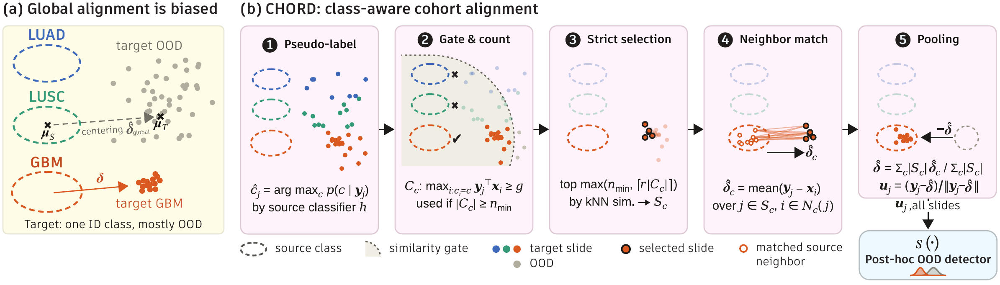

<div align="center">
  <h1>CHORD: Class-Aware Cohort Alignment for<br>Out-of-Distribution Detection in Digital Pathology</h1>
  
</div>

<br>

**Official implementation of the CHORD paper.**

<br>

# 📣 News

- **2026-11:** Code, TITAN slide embeddings and results released.

<br>

# 🌐 Abstract

In digital pathology, AI models may encounter slides from diseases not represented in their training data. Identifying
such cases, known as out-of-distribution (OOD) detection, is challenging because differences in slide preparation and
scanning across hospitals can shift slide embeddings and affect OOD scores, even for known diagnoses. Global alignment
may help, but differences in disease proportions and the presence of unknown diseases can bias the correction. We
introduce CHORD, a training-free alignment method requiring no target labels. CHORD selects target slides resembling
known classes, matches them to source neighbors of the same predicted class, and pools estimates from sufficiently
supported classes into a shared correction without retraining the classifier or detectors. Using slide
representations, we evaluate ten established post-hoc OOD detectors fitted on one cohort and tested on 10,867 slides
from three external cohorts containing known and rare cancer types. Compared with no correction, CHORD improves mean
near-OOD AUROC by approximately 2.5% on average across the three external cohorts, while also improving far-OOD AUROC
and reducing far-OOD FPR95 in each cohort. In contrast, global alignment baselines often degrade detection. These
findings support selective alignment as a step toward distinguishing unfamiliar diagnoses from hospital-related
variation.

<br>

# 📦 Installation

```bash
conda create -n chord python=3.12 && conda activate chord
pip install -r requirements.txt
```

Or with [uv](https://docs.astral.sh/uv/): `uv sync`. Tested with Python 3.12.3 on Linux, CPU only. Package versions
are pinned in `requirements.txt` and `uv.lock`. The TITAN slide embeddings are included, so no GPU or
foundation-model weights are needed.

<br>

# 🚀 Running Experiments

```bash
./run_all.sh          # all experiments, then the paper's numbers and tables (about 15 min on 64 CPU cores)
./run_all.sh --data   # also rebuild data/manifest.csv and data/splits.csv
```

With uv: `uv run ./run_all.sh`. Each step is one script in `scripts/` that writes its results to `results/`:

| Script | Paper | Results |
|---|---|---|
| `run_semisynth`, `run_method_dev`, `summarize_method_dev`, `run_iterations_dev`, `run_variants_dev` | Hyperparameter selection | `step*.csv` |
| `run_final` | Held-out evaluation, what CHORD selects (Sec. 4.1) | `final_*.csv` |
| `run_detectors`, `run_mean_of_ten`, `run_fpr95_ci` | Table 2 | `det_*.csv`, `detector_dev.csv` |
| `run_sensitivity` | Table 3, sensitivity ranges | `sensitivity.csv` |
| `run_ci_refit` | Bootstrap with CHORD refitted per resample | `refit_*.csv` |
| `run_failure_analysis` | Failure case (Sec. 5) | `failure*.csv` |
| `make_paper_tables` | All numbers and tables | `paper/` (`numbers.tex`, `tables/`) |

`make_paper_tables` also checks the claims made in the paper text and stops if one does not hold.

The code is in `src/chord/`: CHORD (`method.py`), the baselines, the ten post-hoc detectors (`detectors.py`), data
loading and metrics.

<br>

# 🗂️ Data

TITAN slide embeddings (768-d) are in `data/titan/<cohort>/<subset>/{data,filenames,labels}.npy`. Set
`CHORD_TITAN_ROOT` to load them from elsewhere. `data/manifest.csv` assigns each slide its role, `data/splits.csv`
holds the patient-level CPTAC splits (ID: 50/15/15/20% train/val/dev/test, stratified by diagnosis), and
`data/meta/` the metadata sources.

| Cohort | ID | Near-OOD | Far-OOD | Slides (ID / near / far) |
|---|---|---|---|---|
| CPTAC (source) | LUAD, LSCC, GBM | HNSCC | PDA, UCEC, BRCA, COAD | 1835 / 228 / 1877 |
| TCGA | LUAD, LUSC, GBM | LGG, HNSC | BRCA, COAD, KIRC, KIRP, SKCM, PAAD | 1912 / 725 / 2792 |
| PLCO | LUAD, LUSC | rare lung carcinomas | BRCA, COAD | 889 / 115 / 1706 |
| EBRAINS | GBM | LGG | other brain tumours | 333 / 361 / 2034 |

Excluded: normal tissue, frozen sections, CPTAC slides without TCIA metadata, TCGA recurrent tumours, PLCO
IHC-stained slides, EBRAINS metastatic tumours, and duplicate embeddings.

<br>

# ⚙️ Hyperparameter Selection

The CHORD settings (`n_min = 20`, `r = 0.1`, matched neighbours, one pass, and one pooled shift rather than iterative
or organ-wise variants) were selected with predefined rules on a semi-synthetic benchmark built solely from CPTAC
development slides, which adds known shifts and varies class proportions and OOD fractions. No target cohort was used
to set them.

- **Benchmark:** 640 cohorts drawn from CPTAC-dev, shifted by `y = x + α·s0·d` (random direction `d`,
  α ∈ {0, 0.25, 0.5, 1}), with OOD fraction ρ ∈ {0, 0.3, 0.6, 0.9}, four class mixes and 10 repetitions.
- **Rule:** lowest mean shift-recovery error. Settings within 0.005 of the best are tied and broken in a predefined
  order (see each script's docstring).
  - estimator × `n_min` ∈ {20, 30, 50} × `r` ∈ {0.1, 0.25, 0.5} → matched, 20, 0.1 (`run_method_dev`)
  - passes `T` ∈ {1, …, 10} → 1 (`run_iterations_dev`)
  - shared vs organ-wise vs class-wise shift → shared (`run_variants_dev`)
- **Fixed beforehand:** gate at the 1st percentile of the CPTAC-val nearest-neighbour similarity, `k = 10`, MNN
  baseline `k = 20`, CORAL weight 0.1.

<br>

# 📄 License

MIT
